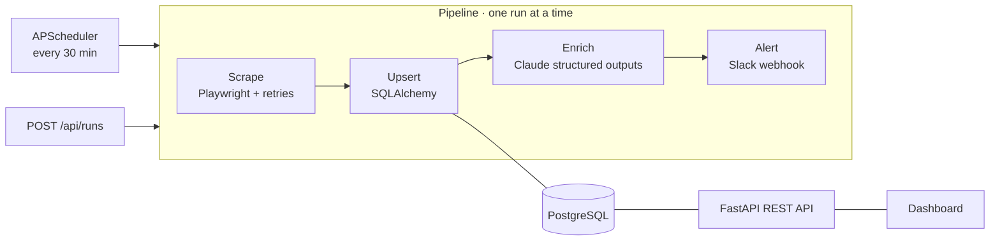

# ◆ TechPulse

**An AI-curated tech news monitor.** TechPulse scrapes Hacker News on a schedule with a headless browser, uses **Claude** to classify, score and summarise every story against your interests, stores everything in **PostgreSQL**, and sends a **Slack** alert only when something matters. A **FastAPI** back end serves a REST API and a live dashboard.

> Built as a compact portfolio project covering browser automation, LLM integration, API design, data modelling, testing and containerised delivery.

     

🎬 **Demo video (4:33):** [docs/techpulse-demo.mp4](docs/techpulse-demo.mp4) (regenerate with `python demo/record_demo.py`)

---

## Architecture



| Stage | What happens | Tech |
|---|---|---|
| **Schedule** | Interval trigger, or on demand via API. An `asyncio.Lock` prevents overlapping runs. | APScheduler |
| **Scrape** | Headless browser loads N pages and extracts rank, title, URL, points, author and comments in one in-page JS pass. Images, fonts and CSS are blocked. Retries use exponential backoff. | Playwright, tenacity |
| **Store** | Idempotent upsert: new stories are inserted, and existing ones get fresh points and comments. | SQLAlchemy 2, PostgreSQL / SQLite |
| **Enrich** | Batches of 30 un-enriched stories are sent to Claude. The response is parsed directly into Pydantic models (category enum, relevance 1–10, summary, tags). | Anthropic SDK, structured outputs |
| **Alert** | Stories at or above `ALERT_THRESHOLD` that haven't been alerted are posted to Slack, exactly once. | httpx |
| **Audit** | Every run is recorded with its trigger, status, counts, enricher, duration and error. | `runs` table |

### Reliability built in
- **Failure isolation:** a failed run is recorded and shown in the dashboard, and never crashes the scheduler.
- **Self-healing:** if enrichment fails, stories stay `relevance IS NULL` and are picked up on the next run.
- **No duplicate alerts:** an `alerted` flag is set when an alert is sent.
- **Offline mode:** without `ANTHROPIC_API_KEY` a deterministic keyword enricher takes over. With `SCRAPER_SOURCE=fixture`, the real Playwright extraction runs against a saved page, which CI and demos use.

---

## Quick start

### Docker (app + PostgreSQL)
```bash
cp .env.example .env          # optional: add ANTHROPIC_API_KEY, SLACK_WEBHOOK_URL
docker compose up --build
```
Open **http://localhost:8000** for the dashboard, or **http://localhost:8000/docs** for the API docs.

### Local (SQLite)
```bash
python -m venv .venv && source .venv/bin/activate     # Windows: .venv\Scripts\activate
pip install -e ".[dev]"
python -m playwright install chromium                 # or set BROWSER_CHANNEL=chrome
cp .env.example .env

techpulse run-once        # one pipeline pass, prints a summary
techpulse serve           # API + dashboard + scheduler on :8000
```

## Configuration

All settings come from environment variables or `.env`, and Pydantic validates them.

| Variable | Default | Purpose |
|---|---|---|
| `ANTHROPIC_API_KEY` | – | Enables Claude enrichment. Without it, the keyword fallback is used. |
| `CLAUDE_MODEL` | `claude-opus-5-5` | Model used for enrichment |
| `INTERESTS` | `AI/LLMs, automation, Python, …` | What "relevant" means to you |
| `ALERT_THRESHOLD` | `8` | Minimum relevance (1–10) that triggers an alert |
| `SLACK_WEBHOOK_URL` | – | Slack incoming webhook. If unset, alerts go to the log. |
| `SCHEDULE_ENABLED` / `SCHEDULE_INTERVAL_MINUTES` | `true` / `30` | Scheduler |
| `SCRAPER_SOURCE` | `live` | `live` or `fixture` (offline) |
| `SCRAPER_PAGES` | `1` | HN pages per run (1–5) |
| `BROWSER_CHANNEL` | – | Use an installed `chrome`/`msedge` instead of the bundled Chromium |
| `DATABASE_URL` | `sqlite:///./data/techpulse.db` | Any SQLAlchemy URL. Compose sets PostgreSQL. |

## API

| Method | Path | Description |
|---|---|---|
| `GET` | `/api/stories` | Filter with `category`, `min_relevance`, `q`, `sort=relevance\|points\|recent`, `limit` |
| `GET` | `/api/stories/{hn_id}` | A single story |
| `GET` | `/api/runs` | Run history |
| `POST` | `/api/runs` | Trigger a run (`202`, or `409` if one is already running) |
| `GET` | `/api/stats` | KPIs, category breakdown, last and next run, active configuration |
| `GET` | `/health` | Liveness and DB check |

## Testing & CI

```bash
pytest -v                 # 18 tests
ruff check . && ruff format --check .
```

- **Enricher:** keyword heuristics, plus the Claude request shape, refusal handling and hallucinated-ID filtering, all against a mocked client.
- **Pipeline:** end-to-end with fakes, idempotency, failure recording, retry after an enrichment failure, and concurrent-run rejection.
- **API:** every endpoint through `TestClient`, including validation errors.
- **Scraper:** the real Playwright extraction against `tests/fixtures/hn_front_page.html`.

GitHub Actions (`.github/workflows/ci.yml`) runs lint, then tests, then a Docker build, then a smoke test against the running container in fixture mode.

## Project layout

```
techpulse/
  config.py      settings (pydantic-settings)
  db.py          engine/session wrapper
  models.py      Story, Run (SQLAlchemy 2 typed ORM)
  scraper.py     Playwright scraper + retry
  enricher.py    ClaudeEnricher (structured outputs) + KeywordEnricher fallback
  notifier.py    Slack / log alerts
  pipeline.py    scrape → upsert → enrich → alert, audited per run
  api.py         FastAPI app factory, scheduler lifespan, routes
  cli.py         `techpulse serve | run-once`
  templates/ static/   dashboard (vanilla JS on the public API)
tests/           pytest suite + HN HTML fixture
demo/            slides + scripted, narrated demo-video recorder
```

## Demo video

`demo/record_demo.py` produces the walkthrough video automatically:

1. starts the app on a fresh database and runs the test suite (its output appears in the video)
2. synthesises narration with neural TTS (`edge-tts`)
3. drives a real browser through slides, a **live** pipeline run, the filters, the API docs and the code walkthrough, recording it with Playwright's video recorder and an injected cursor and subtitles
4. muxes the narration onto the screen recording with ffmpeg (`imageio-ffmpeg`)

```bash
pip install -e ".[video]"
python demo/record_demo.py      # -> demo/out/techpulse-demo.mp4
```
Set `ANTHROPIC_API_KEY` before recording to show Claude enrichment instead of the offline fallback.
